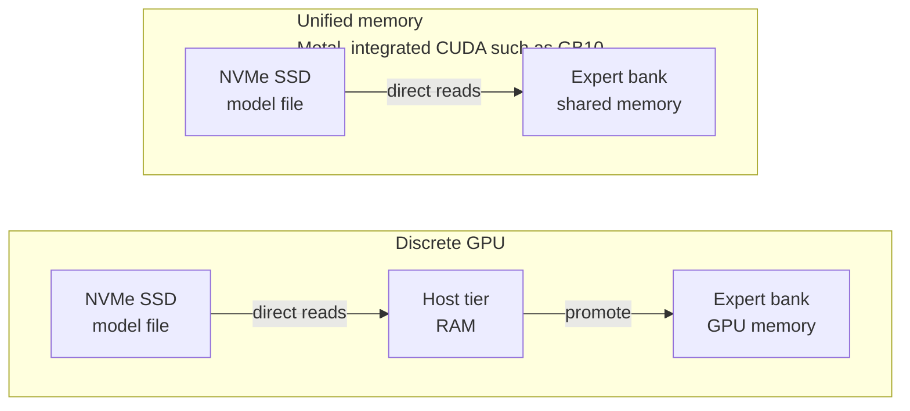
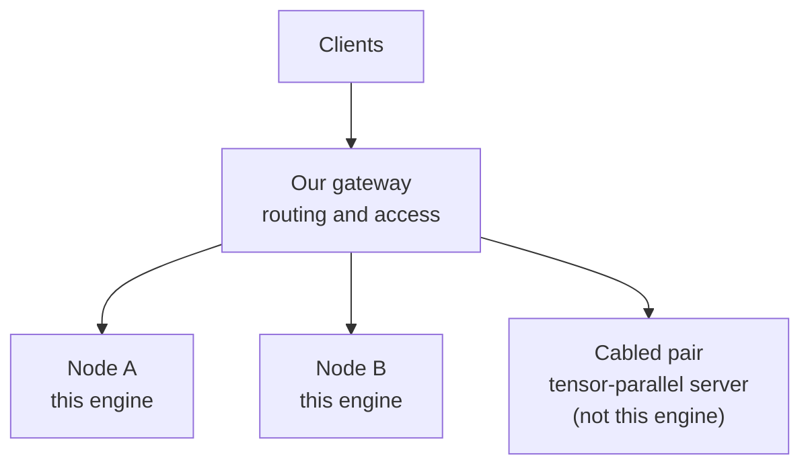

<h1 align="center">GPU-RAM-SSD for local AI network</h1>

<p align="center">
  <strong>A Neyra Labs evaluation of the Magnitude inference engine for a network of independent nodes,<br>each serving one model behind an OpenAI-compatible endpoint.</strong><br>
  Magnitude spreads a sparse mixture-of-experts model across GPU memory, system RAM and NVMe.
</p>

<p align="center">
  <a href="LICENSE"></a>
  <a href="https://github.com/magnitudedev/magnitude"></a>
  
  
</p>

<p align="center"><a href="#how-it-works">How it works</a> · <a href="#what-runs-on-it">Models</a> · <a href="#what-contacts-the-network-inherited-from-upstream">Network contact</a> · <a href="#roadmap">Roadmap</a> · <a href="#faq">FAQ</a></p>

> [!IMPORTANT]
> **Today:** this repository is identical to upstream `magnitudedev/magnitude` at commit `90a4db1`, except for this README.
>
> **Not done yet:** no build, no binaries, no run on our hardware.
>
> **How to read this page:** a statement is either *read in the source* (with the file) or an *upstream claim* we have not reproduced.
>
> **If you want to use the engine, go to [upstream](https://github.com/magnitudedev/magnitude).**

**For:** people following our evaluation on machines such as NVIDIA DGX Spark and Apple silicon, and operators of fleets of OpenAI-compatible nodes who want to know what an SSD tier buys.

**Not for:** anyone who wants an installer or a supported product (use upstream), or multi-node tensor-parallel serving (the engine has none).

## At a glance

| Item | Today |
|---|---|
| **Engine** | Rust, with its own kernel compiler (Seismic) and CPU, CUDA, Metal and Vulkan backends |
| **API** | OpenAI Chat Completions and Responses, Anthropic Messages; one port, `10100` |
| **Hardware** | macOS (Apple silicon, Intel on CPU) · Linux x64 and arm64 · Windows x64 ([table](#hardware)) |
| **Models** | 12 supported in the catalog, from 1.7B dense to 552B mixture-of-experts ([list](#what-runs-on-it)) |
| **Licence** | Apache-2.0 |
| **Upstream** | [magnitudedev/magnitude](https://github.com/magnitudedev/magnitude): committing daily at the fork point, 3,364 commits |
| **This fork adds** | Nothing yet, except this page |

## Why this exists

At Neyra Labs we run a local AI network on machines we already own: each serves a model behind an OpenAI-compatible endpoint. A sparse mixture-of-experts model uses a small share of its weights for each token, so most of its weight can wait on slower storage. That could make a model that does not fit in one machine's fast memory usable on it, if the engine places experts well and reads them ahead of use.

Upstream designed the engine for that case. We want to find out whether it holds on our machines.

**First deliverable:** a reproducible benchmark of one supported mixture-of-experts model on one of our machines, against llama.cpp, with a quality check beside the speed numbers. What we do with the fork follows from that result.

## How it works



An app or a gateway talks to the engine over the OpenAI or Anthropic API on one port.

### Read in the code

- **One ranking, two layouts.** The expert bank keeps what one ranking says (expected reuse, measured from completed steps). **On a discrete GPU** every miss reaches a host tier in RAM first, which fills from the model file; the device's steps serve it from the tier's records in place (some are computed on the CPU), and the host promotes, in the background, the experts the ranking keeps. **On unified memory there is no host tier:** the host lands a file miss straight into a bank record. The rule is in the code: a device whose shared memory lies in its own device memory takes the unified layout, and the code names Metal and "an integrated CUDA device's such as GB10's" as that case; a test builds a recorded GB10 report and asserts it. So by the code's rule a DGX Spark has **two tiers, not three**: shared memory and NVMe. We have not run it. ([`layout.rs`](inference/engine/executor/src/planning/bank/layout.rs), [`qualification.rs`](inference/engine/executor/src/platform/qualification.rs), [`topology/src/tests.rs`](inference/seismic/topology/src/tests.rs)) ([`directory/mod.rs`](inference/engine/executor/src/experts/directory/mod.rs), [`experts/mod.rs`](inference/engine/executor/src/experts/mod.rs))
- **Reads can skip the OS page cache.** Uncached direct reads: `O_DIRECT` on Linux, `F_NOCACHE` on macOS, `FILE_FLAG_NO_BUFFERING` on Windows. Each reader picks a cache policy, and a read falls back to the cache when a filesystem refuses direct IO. On Linux a single `io_uring` thread does the batching when the kernel supports it; otherwise a `pread` worker pool does. ([`seismic/io`](inference/seismic/io/src/lib.rs), [`scheduler/engine.rs`](inference/seismic/io/src/scheduler/engine.rs))
- **Reads ahead of use.** The prefetcher acts on a lookahead router's hint or on the route of rows that are ahead, and reads from the file into staging or the host tier. ([`prefetch.rs`](inference/engine/executor/src/experts/watcher/prefetch.rs))
- **No direct SSD-to-GPU path, no cross-node path.** Storage-to-VRAM DMA and peer RDMA are declared as link kinds marked "future extension"; neither is implemented. ([`fabric.rs`](inference/seismic/io/src/fabric.rs))

### Stated in upstream's design documents

Upstream calls these documents [intended architecture](inference/docs/overview.md); we have not checked them against behaviour.

- **One memory pool per store.** Expert-bank records and KV slabs share a granule pool. When memory is short, old retained prefixes are released first, then cache is given back lowest value per byte first: idle graph slots, retained prefixes, an idle drafter or vision encoder and the bank's slots above its floor. ([`scheduling.md`](inference/docs/engine/scheduling.md))
- **No toolchain at run time.** Packaged execution needs no CUDA toolkit, CMake or Python, and inference needs no network once the engine and a model are installed. ([`distribution.md`](inference/docs/distribution.md))

## What runs on it

From [`inference/catalog/models.json`](inference/catalog/models.json): 23 entries, **12 supported**, 6 deprecated, 5 disabled. A disabled entry records why, for example "GLM DSA attention and its indexer are not implemented yet".

| Supported mixture-of-experts model | Total | Active per token |
|---|---:|---:|
| Qwen 3.6 35B-A3B | 35B | 3B |
| Nemotron 3.5 Bolt 74B-A9B | 74B | 9B |
| Nemotron 3.5 Super VL 120B-A12B | 120B | 12B |
| Qwen 3.8 Flash Next | 180B | 6B |
| GLM-5.3 Flash | 321B | 18B |
| DeepSeek V4.1 Flash | 552B | 16B |

- **Also supported, dense:** Qwen 3.5 4B, Qwen 3.8 27B, Muse Glimmer 30B, Gemma 4 12B, LFM 3 1.7B, Nemotron 3.5 Bolt E4B.
- **Disabled today:** Nemotron 3 Ultra 550B-A55B (its MXFP4 serving path is unfinished), GLM 5.2 753B-A40B, Qwen 3.5 122B-A10B, Nemotron 3 Super 120B-A12B, Laguna S 2.1.

## Hardware

| Backend | Platforms | Floor |
|---|---|---|
| Metal | macOS arm64 | Any Apple silicon Mac, macOS 15 |
| CUDA | Linux x64 and arm64, Windows x64 | Compute capability 8.0 (Ampere), NVIDIA R525 |
| Vulkan | Linux x64 and arm64, Windows x64 | Vulkan 1.3 plus a list of required features; some 1.3 devices are excluded |
| CPU | All hosts, Intel Macs included | x86-64-v2 or AArch64, glibc 2.35 on Linux, macOS 15 on a Mac |

Source: [`inference/docs/compatibility.md`](inference/docs/compatibility.md), which also says that "the R525 floor has not yet been exercised end to end on an R525–R575 driver".

**DGX Spark.** The compatibility table lists **GB10 (DGX Spark)** as a CUDA target at compute capability 12.1, and the docs record GB10-specific driver findings. That shows upstream builds and measures on it. It is not a result of ours; the speed chart upstream publishes for a DGX Spark is an upstream claim we have not reproduced.

## Run it today, with upstream's build

> [!NOTE]
> This repository publishes no installer and no image. The commands start **upstream's** official image, taken from [upstream's Docker guide](docs/installation/docker.mdx) and its [network-access page](docs/api/network-access.mdx), the last one adapted. We have not run them. The image contacts `magnitude.dev` to check for updates (see below for how to stop that); it never updates itself.

```sh
# Linux with an NVIDIA GPU (x64 or arm64); needs the NVIDIA Container Toolkit
docker run -d --name magnitude --restart unless-stopped --gpus all \
  -p 10100:10100 -v magnitude:/data \
  magnitudedev/magnitude
```

On first start it makes a network key and prints it (`docker logs magnitude`). Then:

```sh
docker exec magnitude magnitude models recommend --limit 5
docker exec magnitude magnitude models pull "MODEL_ID"

curl -H "Authorization: Bearer API_KEY" http://ADDRESS:10100/inference/v1/models
```

The OpenAI-compatible API is at `:10100/inference/v1` and the Anthropic-compatible one at `:10100/inference/anthropic`.

## What contacts the network (inherited from upstream)

Inference stays local. The parts around it do not, and a fork inherits all of them. **Read in the source at `90a4db1`:**

| Part | What it contacts and sends | Can you stop it? |
|---|---|---|
| **Update check**: the desktop app, `magnitude serve`, `magnitude update` and the Docker image | `https://magnitude.dev` (set at build time). A signed request that identifies the installation and, once the engine is ready, carries a hardware summary. [Details below](#the-update-check-in-detail). | A switch exists in the code, not run by us |
| Installers `install.sh`, `install.ps1` | `magnitude.dev` (filled in at release) and upstream's GitHub releases. The script says the server counts each request. Linux checks an Ed25519 signature against upstream's key baked in at release; macOS relies on HTTPS, a checksum and Apple code signing; Windows checks the Authenticode publisher. ([`install.sh`](packages/release/resources/install.sh)) | Do not use them; run the container |
| Engine download in the CLI | Upstream's GitHub releases by default. ([`icn/layer.ts`](packages/acn/src/icn/layer.ts)) | Yes: `MAGNITUDE_RELEASE_BASE_URL` |
| Model downloads | `huggingface.co`; sign-in uses upstream's OAuth client id. ([`hugging-face-account.ts`](packages/acn/src/hugging-face-account.ts)) | Not checked |
| Optional | Magnitude's cloud API (needs `MAGNITUDE_API_KEY`), Exa web search (needs `EXA_API_KEY` or a config key), Anthropic and OpenAI with your keys, and ChatGPT's backend when a ChatGPT account header is present. ([`providers`](packages/providers/src), [`inference-gateway.ts`](packages/acn/src/inference-gateway.ts)) | Off unless you set the key |
| Telemetry | No analytics or crash-reporting SDK found; the update check above is the nearest thing. OTLP export exists, off unless set. The TypeScript service reads `MAGNITUDE_OTEL_ENDPOINT`, `OTEL_EXPORTER_OTLP_TRACES_ENDPOINT` and `MAGNITUDE_OTEL=1` (a local collector); the Rust server reads those and also `OTEL_EXPORTER_OTLP_ENDPOINT` and `OTEL_EXPORTER_OTLP_LOGS_ENDPOINT`. ([`tracing.ts`](packages/acn/src/tracing.ts), [`telemetry.rs`](inference/service/server/src/telemetry.rs)) | Off unless the variables are set |

### The update check in detail

Read in the source at `90a4db1`; none of it was run.

- **Where it goes.** The origin set at build time, `https://magnitude.dev` ([`electron.vite.config.ts`](desktop/electron.vite.config.ts)).
- **Who sends it.** The desktop app, `magnitude serve` and the Docker image send it on their own. `magnitude update check`, `download` and `install` send it when no app or `serve` owns the profile, and then without the hardware summary; other commands, such as `models pull`, send nothing. ([`serve-runtime.ts`](cli/src/commands/serve-runtime.ts), [`update-maintenance.ts`](cli/src/server/update-maintenance.ts), [`container-update.ts`](packages/daemon-management/src/application-update/container-update.ts))
- **An identifier that persists.** Every check is signed with a key made once per data directory, and its public key travels with the request, so the server can derive a stable installation id from it. ([`request-auth.ts`](packages/release/src/hosted-update/request-auth.ts))
- **What it carries.** The channel, reason, a timestamp and nonce, app version, OS and OS version (and Linux distribution), architecture, package type (`cli-only`, `mac-zip`, `windows-exe`, an OS package or `docker`), which program sent it, a `User-Agent` with version, architecture and OS, and the outcome of the previous update. ([`client.ts`](packages/release/src/hosted-update/client.ts))
- **A hardware summary, once the engine is ready.** Backend, GPU name, kind, memory and count, why a GPU is unused (free text), CPU model and cores, system memory. ([`update-hardware.ts`](packages/daemon-management/src/application-update/update-hardware.ts))
- **Downloads.** On installed apps they start automatically by default ([`update-preferences.ts`](packages/daemon-management/src/desktop-native/update-preferences.ts)). A `serve` from a standalone install, the Linux package (with passwordless sudo) or a writable macOS app installs updates unattended when idle. The desktop app itself waits for a Restart on every OS; `serve` from a Windows desktop install and containers never install on their own, and the Docker image only announces updates.
- **A switch.** Setting `MAGNITUDE_DEV_DATA_DIR` marks the profile as isolated, and the build then refuses to set up the update source. What you would see is a generic "update setup" failure in `serve` and Docker, or "available in the installed Magnitude app" in the desktop app, not a clear refusal. A development build and a missing `update-configuration.json` also stop the check. `autoDownloadUpdates` stops downloads only. This is **our reading of the code; we have not run it**, and confirming it on the wire is part of step 1 below.
- **Side effects of the switch** (also read, not run). The data directory moves to the path you give and the port to 11101 unless `MAGNITUDE_DEV_PORT` is set. In Docker that breaks `-p 10100:10100` and the image's health check unless you also set `MAGNITUDE_DEV_PORT=10100`; a data path outside `/data` is lost when the container is recreated; and a new data directory means a new network key unless `MAGNITUDE_NETWORK_KEY` is set. CLI commands need the same variable. The desktop app also turns off launch at login and the CLI link. ([`application-bootstrap.ts`](packages/daemon-management/src/desktop-native/application-bootstrap.ts), [`installed-preparation.ts`](packages/daemon-management/src/application-update/installed-preparation.ts))

## Roadmap

These are plans, not features.

**Now: hygiene**
- [ ] Mark modified files, as Apache-2.0 §4(b) asks, and add a `NOTICE` crediting Magnitude AI Inc. (good practice: §4(d) only passes on a NOTICE the work already has, and the tree has none). `LICENSE` names Magnitude AI Inc. as the holder.
- [ ] Disable the upstream-only workflows in this fork (release, Docker Hub, landing-page sync). The tree carries 17 upstream workflows.

**1 · Prove it, using upstream's build**
- [ ] The first deliverable above: one model, one machine, one reproducible benchmark with a quality check. The `mrig` harness lists `bench` and `kl` instruments; we have not run them.
- [ ] Run it with the update check isolated (the `MAGNITUDE_DEV_DATA_DIR` switch above) and look at what actually leaves the machine, so the switch is confirmed on the wire.
- [ ] Measure time to first token on long prompts: streaming experts from SSD may not fit the timeouts a gateway expects.

**2 · Decide how to live next to upstream**
- [ ] The options: consume upstream's releases from a thin integration-and-benchmark repo and send patches upstream (an opt-out for the hardware summary is an obvious first one), or diverge. Upstream is committing daily and has a release pipeline of its own, which is the cost of diverging. The decision follows step 1.

**3 · Make it ours, only if step 2 says diverge**
- [ ] Our own release and signing pipeline. Upstream's image is built from a release payload checked against a manifest by size and checksum, by workflows that need upstream's secrets and build "without attestations".
- [ ] Our own installer origin, update origin and release base URL; our own Hugging Face OAuth client; the hardware summary removed or sent only to a server we run.
- [ ] Rename only what a user sees.

**4 · Put it in the network**
- [ ] Serve it behind our gateway as one more OpenAI-compatible backend. The engine exposes the kind of endpoint our gateway already speaks; we have not tested that.
- [ ] Scale out as **independent nodes**. The engine has no multi-node execution: distributed tensor execution is [outside its architecture](inference/docs/overview.md). Machines joined by a fast cable would use a tensor-parallel server instead.



## Where it sits

Licences as reported by the GitHub API on 2026-11-27. The last column is our plan, not a finding.

| Project | Licence | What it is, in its own words | Our plan |
|---|---|---|---|
| [llama.cpp](https://github.com/ggml-org/llama.cpp) | MIT | "LLM inference in C/C++" | The baseline we will measure against, and the reference for GGUF behaviour |
| [vLLM](https://github.com/vllm-project/vllm) | Apache-2.0 | "A high-throughput and memory-efficient inference and serving engine for LLMs" | Tensor-parallel serving across cabled machines |
| [KTransformers](https://github.com/kvcache-ai/ktransformers) | Apache-2.0 | "A Flexible Framework for Experiencing Heterogeneous LLM Inference/Fine-tune Optimizations" | The closest neighbour in approach; to evaluate |
| [exo](https://github.com/exo-explore/exo) | Apache-2.0 | "Run frontier AI locally." | Pooling several devices; to compare for multi-node |
| [lm-evaluation-harness](https://github.com/EleutherAI/lm-evaluation-harness) | MIT | "A framework for few-shot evaluation of language models." | Quality checks beside the speed numbers |

## FAQ

**Can I install it from here?** No. This repository publishes no installer or image. Use upstream's, with the cautions above.

**Does it pool several machines into one model?** No. Distributed tensor execution is outside the engine's architecture; run one engine per machine.

**Is it faster than llama.cpp or vLLM?** We do not know yet; that is the first deliverable. Upstream's published comparisons are against Ollama, and we have not reproduced them.

## Contributing

Issues and pull requests here are about this fork. A bug that exists upstream belongs upstream first; their [contributing guide](CONTRIBUTING.md) is in the tree and asks for a changeset on every PR.

## Licence and credit

Apache-2.0, see [`LICENSE`](LICENSE), which names **Magnitude AI Inc.** as the copyright holder. This is a fork of **Magnitude** by [magnitudedev](https://github.com/magnitudedev); the engine, the kernel compiler and the apps are the work of upstream's authors and contributors.

Third-party code in the tree carries its own licences: llama.cpp under the ggml authors' MIT licence (`inference/engine/templates/native/LICENSE.llama.cpp`), nlohmann/json (MIT) and Phosphor Icons (MIT, `docs/icons/LICENSE`).

*Magnitude* and its logo are upstream's. This repository is not affiliated with or endorsed by them and does not use their name as its own.
